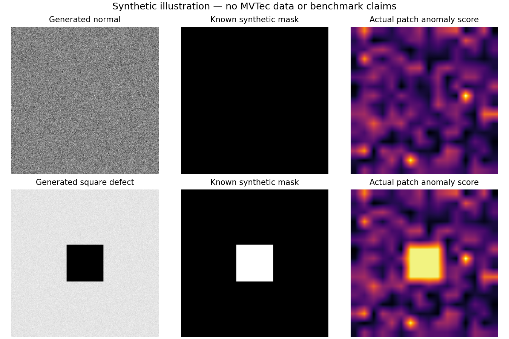
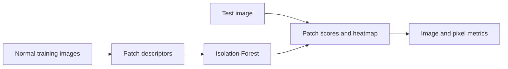

# Industrial Visual Inspection with Anomaly Detection

A CPU-friendly, unsupervised visual-inspection project that learns a baseline from defect-free product images and produces image-level anomaly scores plus a pixel-level heatmap.

[](https://github.com/ayanirfan099/industrial-visual-inspection/actions/workflows/tests.yml) 




This illustration uses six generated normal training images and a separate generated test image with a square defect. It is not MVTec data and establishes no benchmark quality. Reproduce with `python -m pip install matplotlib`, then `PYTHONPATH=src python scripts/plot_synthetic_demo.py`.

## Why this project

Many inspection lines have many examples of normal products and few labeled defects. This project explores a normal-only baseline: extract grayscale patch statistics, fit an Isolation Forest on normal patches, and score patches that differ from the learned baseline.

## Method




1. Resize images to 256 × 256 grayscale.
2. Split each image into 16 × 16 patches and extract intensity and gradient statistics.
3. Fit an Isolation Forest using only defect-free training images.
4. Return a high-is-anomalous image score and a 256 × 256 anomaly map.
5. Evaluate image-level and pixel-level AUROC / average precision when masks are available.

The detector is an interpretable, lightweight baseline. It is not a state-of-the-art inspection system; it may miss texture, shape, lighting, and viewpoint changes.

## Dataset

Use the [MVTec AD dataset](https://www.mvtec.com/research-teaching/datasets/mvtec-ad), a benchmark for industrial anomaly detection with defect-free training images, test defects, and pixel-precise anomaly masks. Download one category and extract it locally; dataset files are not bundled in this repository. MVTec AD is licensed CC BY-NC-SA 4.0 and is not permitted for commercial use. Review its terms before using it beyond non-commercial research or portfolio work.

Expected layout:

```text
mvtec_anomaly_detection/
└── bottle/
    ├── train/good/*.png
    ├── test/good/*.png
    ├── test/<defect_type>/*.png
    └── ground_truth/<defect_type>/*_mask.png
```

## Run

```bash
python -m venv .venv
# Windows: .venv\Scripts\activate
# macOS/Linux: source .venv/bin/activate
python -m pip install -e .
python -m unittest discover -s tests -v
visual-inspection --data-root /path/to/mvtec_anomaly_detection --category bottle --report reports/bottle.json
visual-inspection --data-root /path/to/mvtec_anomaly_detection --category bottle --preview-image /path/to/sample.png --preview-output reports/preview.png
```

Use `--limit-good` and `--limit-defects` for a quick CPU smoke run. The same category should be used for training and evaluation. Defect labels and masks are used only for evaluation, never to fit the detector.

### Benchmark availability

No MVTec AD dataset is bundled or was obtained during this update. The legacy official bottle archive URL returned HTTP 404 on 1 November 2026. Use the current official dataset page above to obtain a permitted category; the existing CLI commands specify the exact local layout and report/preview options. No synthetic metric is substituted for an MVTec result.

## What to report

Report image AUROC and average precision, plus pixel AUROC and average precision when masks are present. Compare at least one threshold against a stated false-alarm rate. Keep results separated by category and include the exact dataset subset and command. Do not describe smoke-test or synthetic unit-test results as benchmark results.

## Repository structure

- `src/inspection/features.py`: preprocessing and patch descriptors.
- `src/inspection/model.py`: normal-only detector and anomaly maps.
- `src/inspection/data.py`: MVTec AD loader.
- `src/inspection/evaluation.py`: image/pixel evaluation metrics.
- `src/inspection/cli.py`: command-line entry point.
- `tests/`: deterministic synthetic unit tests; no dataset download needed.

## Next engineering steps

- Compare the handcrafted baseline with a pretrained feature extractor and document the tradeoff.
- Add image-level threshold selection on a validation split, never on the final test set.
- Save heatmaps and side-by-side original/ground-truth/prediction visualizations.
- Track per-category results and inference time on CPU.
